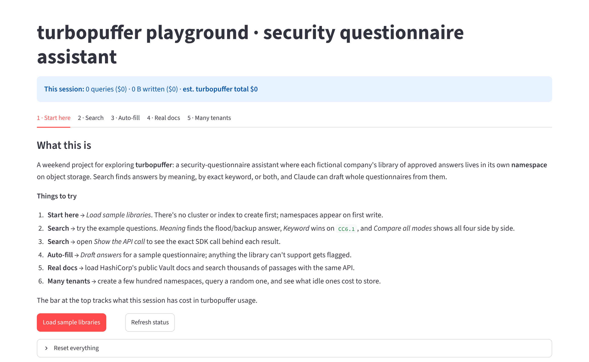

# turbopuffer playground

A hobby project for poking at [turbopuffer](https://turbopuffer.com), the search engine built on object storage. I wanted to try hybrid search, built-in embeddings and reranking, and the one-namespace-per-customer pattern on something a bit more realistic than a quickstart, so I built a small Streamlit app around a made-up scenario: a security-questionnaire assistant.

Each fictional company keeps a library of approved answers ("Is data encrypted at rest?", "What's your RPO?") in its own namespace. The app searches those answers a few different ways and can draft answers to a whole questionnaire. All company names and answers are invented.



## What's inside

| Tab | What it does |
|---|---|
| Start here | Loads two small sample libraries and shows each namespace's size and storage cost |
| Search | Vector, keyword (BM25), hybrid (RRF) and reranked search, with filters, the exact SDK call and the cost of each query |
| Auto-fill | Drafts answers to a list of questions from the approved answers, using Claude if you add a key |
| Real docs | Pulls HashiCorp's public Vault docs from GitHub, chunks them by heading and makes them searchable |
| Many tenants | Creates hundreds of tiny namespaces and compares cold and warm queries |

A small meter at the top estimates what the current session has cost in turbopuffer usage.

## Running it

Locally:

```bash
pip install -r requirements.txt
export TURBOPUFFER_API_KEY=tpuf_...
streamlit run app.py
```

On Streamlit Community Cloud (free): fork the repo, create an app from it with `app.py` as the main file, and add your keys under **Advanced settings → Secrets**:

```toml
TURBOPUFFER_API_KEY = "tpuf_..."
APP_PASSWORD = "choose-a-password"     # recommended, since the app writes to your account
# ANTHROPIC_API_KEY = "sk-ant-..."     # optional: Claude-drafted answers in Auto-fill
# GITHUB_TOKEN = "github_pat_..."      # optional: only if GitHub rate-limits the docs loader
```

## Notes

- Everything lives in namespaces starting with `tpdemo-`. **Reset everything** on the first tab deletes them.
- Cost figures are rough estimates from turbopuffer's public pricing and leave out embedding and reranking charges.
- Built-in embedding and reranking depend on your turbopuffer plan. If reranking isn't available, search falls back to fused results.
- Free Streamlit apps go to sleep when nobody visits; the first load after that takes about 30 seconds.

## License

MIT. See [LICENSE](LICENSE).
